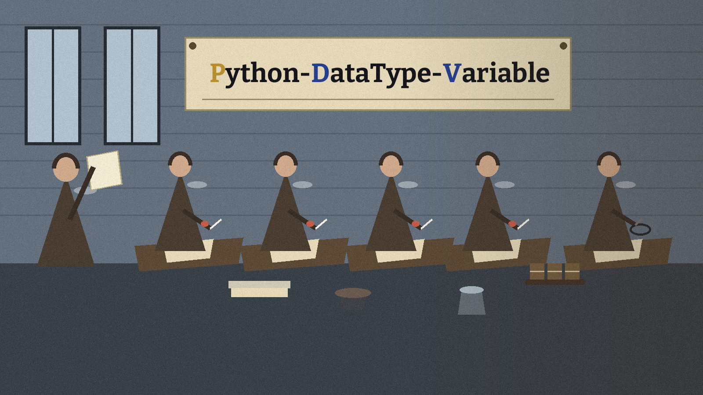

# Python-DataType-Variable

Basic Python datatype and variable script




## The binding

The whole working part of `variable.py` is two lines:

```python
keys = "fun"
print(keys)
```

A short comment at the top of the file says what the two lines mean: bind a value to a name, then use the name. The name `keys` holds a string here.

> **Marginal gloss, in the lapis bracket:** a variable is a label stuck on a value, not a box built for one kind of thing. The same name could later be tied to a whole number or a list, and the print call would still show whatever it points at on that run.


## The output

Running the file prints one word:

```
fun
```

> **Marginal gloss:** "fun" is the whole output. Nothing follows it, and that honesty about size is part of the lesson.


## Trying it

```bash
python3 variable.py
```

Python on its own is enough, with no added libraries. Change the string between the quotes, run the file again, and watch the printed word change while the rest of the file stays untouched. That edit and rerun loop is the only interaction this repo offers.

## Files

- `variable.py`: the whole program, one assignment and one print call.
- `logo.png`, `banner.png`, `intro-banner.png`: generated branding for this repo.
- `LICENSE`: license file.
